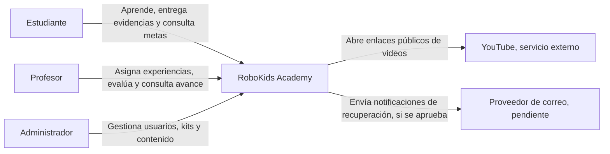
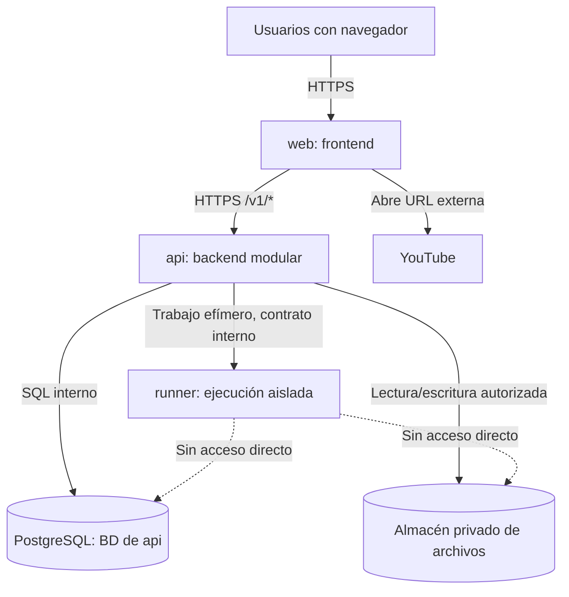

# Arquitectura de software — RoboKids Academy

**Versión documental:** 0.3.0  
**Estado:** Propuesto  
**Fecha:** 2026-11-23  
**Alcance:** Diseño lógico preliminar (no implementación ni decisión aprobada).

## 1. Propósito y fuentes de verdad

Definir los límites técnicos, las dependencias y los mecanismos necesarios para cubrir el catálogo de [RF](../01-requerimientos/RF.md), [RNF](../01-requerimientos/RNF.md), [necesidades](../01-requerimientos/necesidades.md) y [HU](../02-historias/README.md), sin reproducir sus definiciones. Los detalles de entidades están en [modelo-datos.md](modelo-datos.md), rutas y contratos en [api.md](api.md), decisiones en [ADR](adr/) y diagramas editables en [04-diagramas](../04-diagramas/).

> PENDIENTE: confirmar alcance MVP, responsables, hosting, presupuesto, concurrencia, retención y requisitos legales aplicables a datos de menores. Ninguna tecnología, versión o decisión de este documento se considera aprobada.

## 2. Principios

1. API como frontera de autorización; nunca confiar en permisos del navegador.
2. Monolito **modular** en el MVP, con límites internos explícitos, separación de datos y contratos; no microservicios por módulo académico.
3. Ejecución de código de estudiantes **fuera del proceso API**, sin privilegios ni acceso directo a datos académicos.
4. Contenido pedagógico versionable: una experiencia asignada referencia una versión publicada del kit.
5. Recompensas idempotentes y transaccionales, separadas de calificaciones.
6. Separación entre archivos (manuales/evidencias) y metadatos relacionales; sin URLs públicas de evidencias privadas.
7. Sincronización de bloques, texto y simulación **solo donde exista compatibilidad probada**; no asumir conversión bidireccional.

## 3. C4 nivel 1 — Contexto

Fuente: [c4-contexto.mmd](../04-diagramas/c4-contexto.mmd).

YouTube es un servicio externo para abrir videos; no se requiere copiar videos a nuestro almacenamiento. El servicio de correo es una dependencia **propuesta** para [RF-004](../01-requerimientos/RF.md).

## 4. C4 nivel 2 — Contenedores

Fuente: [c4-contenedores.mmd](../04-diagramas/c4-contenedores.mmd).

| Componente lógico | Repositorio propuesto | Nombre de carpeta/servicio Docker | Responsabilidad | Almacenamiento |
|---|---|---|---|---|
| web | `RoboKids-Academy-web` | `web` | UI y editores, consume API, muestra recursos; no decide permisos | Sin BD propia |
| api | `RoboKids-Academy-api` | `api` | Autenticación, grupos, kits, actividades, entregas, evaluación, metas, recompensas y proyectos | PostgreSQL (propiedad de `api`) + metadatos de archivos |
| runner | `RoboKids-Academy-runner` | `runner` | Ejecuta solamente trabajos admitidos, con límites y aislamiento | Sin BD permanente; artefactos efímeros |

Los módulos internos de `api` no son repositorios independientes: `identity`, `academics`, `discovery`, `assessments`, `rewards`, `projects`, `simulation` y `audit`. Se evitarán referencias directas a tablas ajenas fuera de servicios/reposititorios del módulo. `simulation` queda como extensión pendiente de alcance.

> PENDIENTE: aprobar el nombre exacto de cada componente y su organización en GitHub antes de crear repositorios y Docker Compose.

## 5. Módulos internos y mapeo a RF

| Módulo | Función | RF cubiertos |
|---|---|---|
| `identity` | Cuentas, roles y recuperación | RF-001 a RF-004 |
| `academics` | Perfiles, grupos, cursos y asignaciones | RF-005 a RF-010 |
| `discovery` | Kits, contenidos narrativos, pasos STEM, manuales y videos | RF-011 a RF-025, RF-049 |
| `assessments` | Actividades, entregas, cuestionarios, calificaciones y avance | RF-026 a RF-033 |
| `rewards` | Metas, validación, XP, insignias, niveles y recompensas | RF-034 a RF-040, RF-050 |
| `projects` | Proyectos por bloques/Python, versiones y ejecución autorizada | RF-041 a RF-046 |
| `simulation` | Experiencias virtuales e integración compatible | RF-047, RF-048 |
| `audit` | Registro transversal de cambios sensibles | RNF-014 |

La atribución de RF es un **mapa arquitectónico**, no altera la fuente canónica [RF.md](../01-requerimientos/RF.md) ni su prioridad [moscow.md](../01-requerimientos/moscow.md).

## 6. Stack propuesto (no aprobado)

| Capa | Tecnología candidata | Versión |
|---|---|---|
| Frontend | Next.js / React / TypeScript | PENDIENTE |
| Editor visual | Blockly | PENDIENTE |
| Editor textual | Monaco Editor | PENDIENTE |
| Backend HTTP | NestJS / TypeScript | PENDIENTE |
| Persistencia | PostgreSQL con ORM Prisma o equivalente | PENDIENTE |
| Ejecución segura | `runner` en proceso aislado y sandbox de contenedores/VM según evaluación | PENDIENTE |
| Archivos | Almacenamiento privado local u objeto compatible S3 | PENDIENTE |
| Despliegue | Docker Compose inicialmente; alternativa gestionada si escala | PENDIENTE |
| Simulación | Canvas / Phaser u otra librería según casos de uso | PENDIENTE |

## 7. Flujos críticos

### 7.1. Kit educativo y recorrido pedagógico
1. Un administrador autorizado carga la ficha y los contenidos de etapas, materiales y recursos; publica una **versión**.
2. Profesor crea/asigna una experiencia a grupo o estudiante; la asignación referencia la versión del kit.
3. Estudiante consulta solo asignaciones y recursos permitidos; accede a saberes previos, narrativa, manuales y enlaces de YouTube.
4. El sistema registra avance en actividades/etapas conforme [RF-032](../01-requerimientos/RF.md), nunca por apertura de página únicamente si existe requisito de validación.

### 7.2. Entrega y evaluación
1. Estudiante obtiene acceso a actividad de su grupo, envía evidencia mediante metadatos o archivo privado.
2. `api` valida rol, pertenencia y límites de archivo. Asocia evidencia a entrega y registra fecha/estado.
3. Profesor autorizado revisa y emite retroalimentación; se audita cualquier modificación sensible.
4. Se evalúan metas dependientes de la **validación**, sin inferir calificación automática salvo RF aprobado.

### 7.3. Meta → recompensa
1. Evento de cumplimiento validado llega a `rewards` con identidad de operación.
2. Una transacción verifica elegibilidad, regla y ausencia de adjudicación previa.
3. Registra la adjudicación con índice único por `(estudiante, meta, regla, hito)` o clave de negocio aprobada.
4. Retorna la recompensa existente ante reintento idéntico; conflicto explícito si el reintento discrepa.
5. Registra auditoría con actor, fecha y origen de validación.

### 7.4. Python y bloques
1. `web` edita y guarda proyecto por [RF-041 a RF-046](../01-requerimientos/RF.md).
2. Para programas permitidos, `api` valida tamaño, recursos, cuota y acceso al proyecto.
3. `runner` recibe solo trabajo efímero (sin token de usuario), usa permisos mínimos, red deshabilitada por defecto y cuotas de CPU/RAM/tiempo.
4. Resultado limitado y saneado vuelve a `api` y se muestra en `web`; archivos privados no son montados en la ejecución.
5. Conversión bloques → código o integración con simulador se habilita solamente mediante adaptador compatible, nunca por supuesto general.

## 8. Puertos, comunicación y despliegue

| Canal | Protocolo / puerto interno propuesto | Exposición | Estado |
|---|---|---|---|
| Navegador a reverse proxy | HTTPS / 443 | Público | Propuesto |
| Reverse proxy a `web` | HTTP / 3000 | Privado | Propuesto |
| `web` a `api` | HTTPS `/v1` (proxy) / 3001 | API protegida por autenticación | Propuesto |
| `api` a PostgreSQL | TCP / 5432 | Solo red privada | Propuesto |
| `api` a `runner` | Canal interno autenticado; puerto PENDIENTE | Solo red privada | Pendiente |
| `api` a almacenamiento | API privada / ruta interna | No expuesta | Pendiente |

Despliegue propuesto para piloto: un host con reverse proxy, `web`, `api`, PostgreSQL, almacenamiento de archivos privado y `runner` aislado en infraestructura separada **si el modelo de amenazas así lo exige**. Los servicios `api`, PostgreSQL y almacenamiento no deben exponerse directamente a Internet. Copias de seguridad cifradas y prueba de restauración. Los recursos físicos y SLO deben derivarse de RNF medibles.

> PENDIENTE: definir proveedor/host, dominio, TLS, capacidad, RPO, RTO, política de backups, gestión de secretos, entornos dev/staging/prod y despliegue seguro de ejecución no confiable.

## 9. RNF críticos → mecanismos propuestos

| RNF | Mecanismo verificable propuesto | Decisión/umbral pendiente |
|---|---|---|
| RNF-001 | Hash robusto (Argon2id candidato), parámetros revisados en pruebas | Parámetros y política |
| RNF-002 | Rate limiting por cuenta/IP y registro de intentos | Ventana y máximo |
| RNF-003 | RBAC + validación de pertenencia en cada endpoint; pruebas negativas | Matriz completa de permisos |
| RNF-004 | `runner` sin privilegios, filesystem limitado, red cerrada, límites cgroups/VM, timeout y cancelación | Cuotas y tecnología de sandbox; ADR-002 |
| RNF-005 | Minimización, control de acceso, cifrado en tránsito, retención y revocación de enlaces | Política para menores y base legal |
| RNF-006 | Paginación, índices, perfilado y pruebas p95 | p95, milisegundos, concurrencia |
| RNF-007 | Health checks, monitoreo y reinicio controlado | Disponibilidad objetivo |
| RNF-008 | Backup y ejercicios de restauración | RPO/RTO |
| RNF-009 | Pruebas de tareas con estudiantes/profesores | Muestra, tasa y tiempos |
| RNF-010 | Semántica y teclado, auditoría WCAG | Nivel/versión |
| RNF-011 | Matriz de navegadores y pruebas E2E | Versiones objetivo |
| RNF-012 | CI con pruebas unitarias, integración y contratos | Cobertura/puertas CI |
| RNF-013 | Transacción y clave única + pruebas concurrentes | Escenario/cantidad de solicitudes |
| RNF-014 | Registro de eventos inmutable por aplicación, con actor y timestamp | Retención/eventos |
| RNF-015 | Idempotency-Key y controles transaccionales para envíos | Número de reintentos |

**Advertencia:** de acuerdo con el estándar, RNF con umbrales pendientes **no están aprobados ni son RNF completamente verificables**. No se inventan valores.

## 10. Seguridad y privacidad

- Cuentas de menores: consentimiento, representación, acceso y retención deben definirse con asesoría jurídica aplicable antes del lanzamiento.
- Backend comprueba rol **y contexto académico**, no solo rol global.
- Manuales públicos pueden tener enlaces controlados; entregas, notas y datos personales usan acceso privado.
- Ingreso de archivos: tipos permitidos, validación, tamaño, análisis antimalware según amenaza y URLs firmadas con expiración aprobada.
- `runner` está separado por frontera de confianza del sistema académico; no basta un contenedor Docker estándar como garantía de aislamiento ante código hostil.
- Logs evitan imprimir contraseñas, tokens, archivos de estudiantes o información sensible.

## 11. ADR y pendientes

- [ADR-001](adr/ADR-001-monolito-modular.md): monolito modular vs microservicios.
- [ADR-002](adr/ADR-002-ejecucion-aislada.md): entorno seguro de ejecución.
- [ADR-003](adr/ADR-003-contenido-versionado.md): versiones de kits.
- [ADR-004](adr/ADR-004-recompensas-idempotentes.md): adjudicación única de recompensas.

Todos los ADR están **Propuestos**, no aceptados. Véanse el modelo y contrato API antes de implementación. La documentación no declara cumplimiento de los 50 RF, solo diseño conceptual de su soporte.
