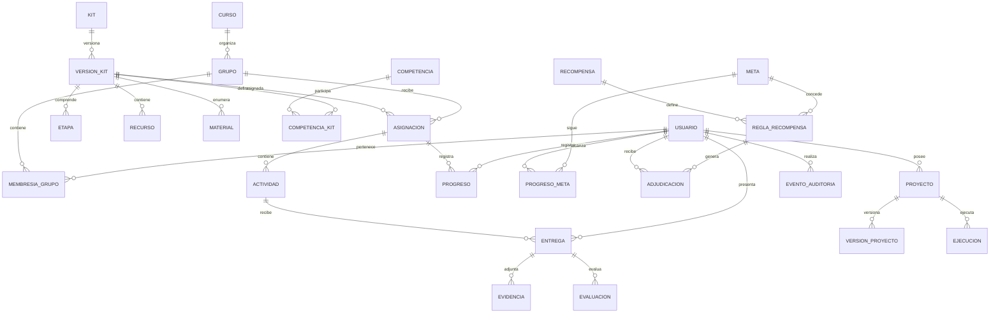

# Modelo de datos — RoboKids Academy

**Estado:** Propuesto · **Versión documental:** 0.3.0  
**Alcance:** Modelo lógico inicial para RF-001 a RF-050. Las entidades y sus nombres no constituyen migraciones aprobadas.

## 1. Fuente canónica

Los conceptos de negocio definidos en [RF.md](../01-requerimientos/RF.md) se representan en este diccionario y en el ER editable [modelo-er.mmd](../04-diagramas/modelo-er.mmd). Esta es la **fuente de verdad del modelo**; otros archivos lo enlazan, sin mantener copias del diccionario.

> PENDIENTE: definir identificación institucional, política de datos personales, cardinalidades finas, claves compuestas, tipos definitivos y retención. Los identificadores internos se proponen UUID.

## 2. ER inicial

> PENDIENTE: la asignación individual, autorías y vínculos de actividad a resultados de aprendizaje exigirán tablas puente adicionales en la especificación física.

## 3. Diccionario lógico mínimo

| Entidad | Clave / campos propuestos | Responsabilidad y RF |
|---|---|---|
| `Usuario` | `id`, `nombre`, `email`, `password_hash`, `estado`, `created_at` | Cuentas y perfiles: RF-001, 003, 005, 006 |
| `Rol`, `Permiso`, `UsuarioRol` | `id`, `codigo`, claves de asociación | RBAC: RF-002 |
| `TokenRecuperacion` | `id`, `usuario_id`, `token_hash`, `expira_at`, `usado_at` | Recuperación: RF-004 |
| `Curso` | `id`, `nombre`, `estado` | Cursos: RF-009 |
| `Grupo` | `id`, `curso_id`, `profesor_id`, `nombre` | Grupos: RF-007, 008 |
| `MembresiaGrupo` | `id`, `grupo_id`, `estudiante_id`, `estado` | Matrícula/vinculación: RF-008 |
| `Kit` | `id`, `codigo`, `titulo`, `categoria`, `nivel`, `estado` | Catálogo, filtros y gestión: RF-011, 012, 020, 049 |
| `VersionKit` | `id`, `kit_id`, `numero`, `estado_publicacion`, `objetivos`, `narrativa` | Contenido y publicación: RF-013, 020, 021, 022 |
| `Etapa` | `id`, `version_kit_id`, `orden`, `tipo`, `contenido` | Saberes previos, fundamentación, construcción, experimentación: RF-013 a 018 |
| `Material` | `id`, `version_kit_id`, `nombre`, `funcion`, `seguridad`, `cantidad` | Componentes y medidas: RF-016 |
| `Recurso` | `id`, `version_kit_id`, `etapa_id?`, `tipo`, `uri`, `visibilidad`, `titulo` | Manuales, documentos, video YouTube, gestión: RF-023, 024, 025 |
| `Competencia` | `id`, `nombre`, `descripcion` | Competencias STEM: RF-019 |
| `ResultadoAprendizaje` | `id`, `codigo`, `descripcion`, `criterio_evidencia` | Resultados de aprendizaje: RF-019 |
| `CompetenciaKit`, `ResultadoKit` | claves de asociación | Kit ↔ competencia/resultado: RF-019 |
| `Asignacion` | `id`, `version_kit_id`, `grupo_id?`, `estudiante_id?`, `profesor_id`, `fecha` | Asignación de experiencias: RF-010 |
| `Actividad` | `id`, `asignacion_id`, `tipo`, `instrucciones`, `fecha_limite`, `estado` | Creación y asignación: RF-026, 027 |
| `ActividadDestinatario` | `id`, `actividad_id`, `grupo_id?`, `estudiante_id?` | Destinatarios por grupo/estudiante: RF-027 |
| `Cuestionario`, `Pregunta`, `Opcion`, `Respuesta` | `id`, claves de relación, `contenido` | Quizzes y respuestas: RF-030 |
| `Entrega` | `id`, `actividad_id`, `estudiante_id`, `estado`, `idempotency_key`, `enviada_at` | Entregas: RF-028, RNF-015 |
| `Evidencia` | `id`, `entrega_id`, `tipo`, `ubicacion_privada_o_url`, `mime` | Adjuntos, fotos, videos/enlaces: RF-028 |
| `Evaluacion` | `id`, `entrega_id`, `profesor_id`, `calificacion?`, `retroalimentacion`, `fecha` | Revisión/calificación: RF-029, 031 |
| `Progreso` | `id`, `estudiante_id`, `asignacion_id`, `etapa_id?`, `estado`, `actualizado_at` | Progreso y reporte: RF-032, 033 |
| `Meta` | `id`, `nombre`, `condicion`, `actividad_id?`, `resultado_id?` | Metas educativas: RF-034 |
| `ProgresoMeta` | `id`, `estudiante_id`, `meta_id`, `estado`, `validada_at`, `evidencia_id?` | Cumplimiento y vistas: RF-035, 038 |
| `Recompensa` | `id`, `tipo`, `nombre`, `puntos_xp?`, `insignia_id?`, `nivel_id?` | Recompensas XP, insignias y niveles: RF-036, 038-040, 050 |
| `ReglaRecompensa` | `id`, `meta_id`, `recompensa_id`, `unica`, `vigencia` | Condiciones de adjudicación: RF-036, 037 |
| `Adjudicacion` | `id`, `regla_id`, `estudiante_id`, `hito_clave`, `idempotency_key`, `otorgada_at` | Otorgamiento no duplicado: RF-036, 037; RNF-013 |
| `Insignia`, `Nivel` | `id`, `codigo`, `criterio` | Insignias y niveles: RF-040, 050 |
| `Proyecto` | `id`, `estudiante_id`, `tipo`, `titulo`, `estado` | Proyectos bloques/Python: RF-041, 042, 044, 046 |
| `VersionProyecto` | `id`, `proyecto_id`, `contenido`, `version`, `lenguaje` | Edición/guardado: RF-042, 046 |
| `Ejecucion` | `id`, `proyecto_id`, `version_id`, `estado`, `salida_limitada`, `iniciada_at`, `terminada_at` | Ejecución controlada: RF-043, 045 |
| `EscenarioSimulacion`, `SimulacionProyecto` | `id`, `tipo`, `configuracion`, `proyecto_id` | Simulación/integración: RF-047, 048 |
| `EventoAuditoria` | `id`, `actor_id`, `accion`, `entidad`, `entidad_id`, `fecha`, `detalle_minimo` | RNF-014 |

## 4. Reglas de integridad y privacidad

- `VersionKit(kit_id, numero)` única; versión publicada es inmutable o requiere nueva versión.
- `MembresiaGrupo(grupo_id, estudiante_id)` única para membresía activa según política.
- `Adjudicacion` con índice único por clave de adjudicación acordada; nunca otorgar XP dos veces por el mismo hito si la regla es única.
- `Entrega` usa clave de idempotencia por estudiante/actividad/operación; política de reenvío por definir.
- Las referencias a archivos deben exigir autorización por solicitud; no guardar archivos binarios en tablas académicas.
- Las calificaciones nunca se infieren directamente de los puntos XP.

> PENDIENTE: aprobar invariantes, normalización, índices, tipos de archivos y soporte para versiones históricas en informes.
